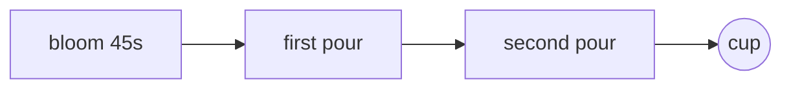

# Pour-over

A 15g dose on the V60, the way the [[Beans]] and the [[Grinder settings]] have settled this month. Every cup goes in the [[Brew log]].

- [x] rinse the filter
- [x] bloom for 45 seconds
- [ ] try a coarser grind on the Ethiopian
- [ ] weigh the kettle, not the cup

```ts
export function pours(dose: number, ratio = 16) {
  const water = dose * ratio;
  const bloom = dose * 2;
  const rest = (water - bloom) / 2;

  return [bloom, rest, rest];
}
```


